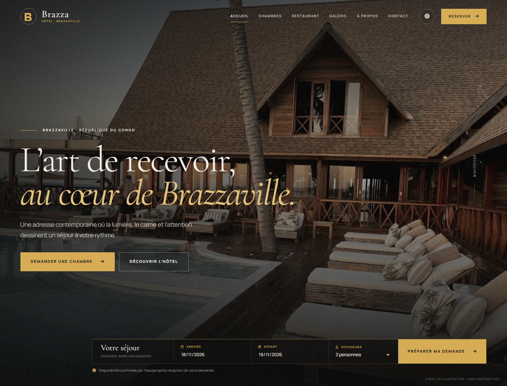
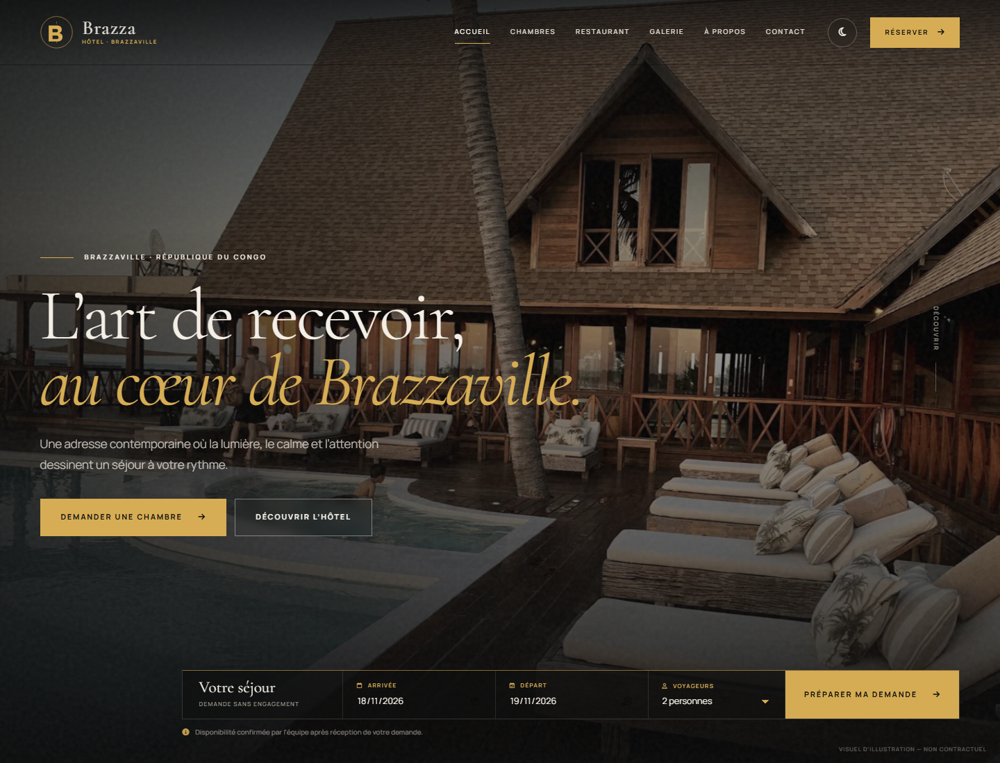
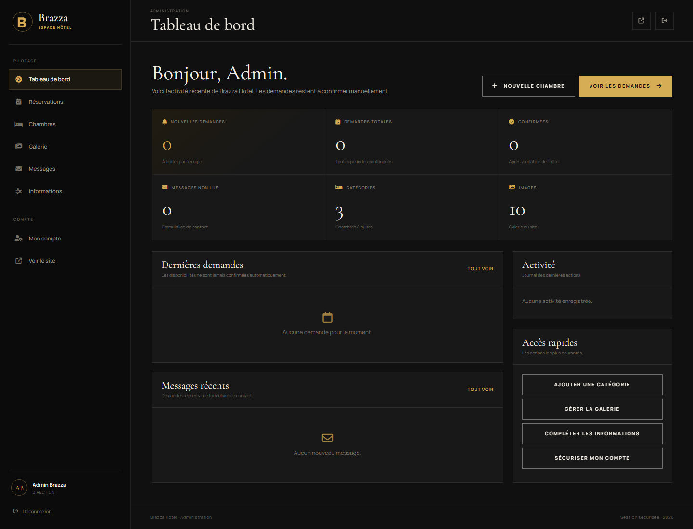

# Brazza Hotel — Site officiel & demandes de réservation

Site premium, responsive et sécurisé pour **Brazza Hotel**, à **Brazzaville, République du Congo**.
Application PHP 8.2+ / MySQL, sans framework, avec une interface publique éditoriale et un espace
d'administration complet.

> **État du projet :** fondation, site public, demande de réservation et administration fonctionnels.
> Les informations officielles de l'hôtel (adresse, téléphone, tarifs, photos, histoire, carte du
> restaurant) ne sont **pas inventées** : elles restent vides et sont affichées comme « à confirmer ».





---

## 1. Informations vérifiées et contenus de démonstration

| Élément | Statut |
|---|---|
| Nom « Brazza Hotel » | Confirmé par le brief |
| Ville : Brazzaville, République du Congo | Confirmé par le brief |
| Adresse, téléphone, e-mail, WhatsApp | **Non fournis — affichés comme à confirmer** |
| Tarifs des chambres | **Non publiés — `price_per_night = NULL`, affiché « Tarif sur demande »** |
| Catégories de chambres, services, restaurant | **Aperçus éditoriaux `content_status = 'demo'`** |
| Photographies | **Illustrations Unsplash non contractuelles**, jamais présentées comme l'hôtel |
| Avis clients, étoiles, labels, certifications | **Aucun** |

Chaque fiche de démonstration porte un badge « Aperçu » ou « Démo ». Dans l'administration, une
valeur ne peut être marquée « Vérifié » qu'après validation explicite par l'hôtel.

---

## 2. Fonctionnalités livrées

### Site public
- **Écran de chargement** plein écran animé, adapté aux deux thèmes, avec délai de sécurité et repli sans JavaScript.
- **Thème sombre et thème clair commutable** dans l'en-tête, avec mémorisation du choix.
- Accueil cinématographique, navigation responsive, hero avec formulaire de préparation de séjour.
- Présentation de l'hôtel, services éditoriaux, chambres mises en avant, restaurant, galerie.
- Pages Chambres (liste + fiche), Restaurant, Galerie filtrable avec lightbox, À propos, Contact.
- Demande de réservation avec validation serveur, enregistrement MySQL et référence unique.
- Formulaire de contact sécurisé.
- WhatsApp conditionnel : le bouton n'apparaît que si un numéro officiel est configuré.
- Google Maps en localisation générale (adresse exacte à confirmer).
- SEO : URLs françaises, balises meta, Open Graph, JSON-LD Hotel, sitemap dynamique, robots.txt.
- Accessibilité : structure sémantique, skip link, focus visible, labels, contrastes, `prefers-reduced-motion`.

### Administration (`/admin`)
- Authentification par e-mail + mot de passe haché, sessions durcies, expiration d'inactivité.
- Tableau de bord : demandes, messages, chambres, galerie, journal d'activité.
- Réservations : filtres, fiche détaillée, notes internes, changement de statut.
- Chambres : CRUD complet, tarif officiel, SEO, statut vérifié/démo, téléversement multi-images.
- Galerie : téléversement, catégories, mise en avant, suppression.
- Messages de contact : liste, fiche, statut.
- Paramètres du site : coordonnées, horaires, restaurant, réseaux sociaux, indicateur « vérifié ».
- Compte : nom, e-mail, changement de mot de passe.

### Réservation
Les demandes sont **enregistrées mais jamais confirmées automatiquement**. Le site n'affiche aucune
disponibilité en temps réel et ne prétend jamais qu'une chambre est libre.

---

## 3. Stack technique

- PHP 8.2+ natif, architecture MVC inspirée, PSR-4 maison.
- MySQL 8 / MariaDB 10.4+ via PDO, requêtes préparées exclusivement.
- HTML5 sémantique, CSS3 sur mesure, JavaScript ES6.
- Font Awesome 6 (auto-hébergé), GSAP 3 (accueil uniquement, désactivé si réduction des animations).
- Polices Cormorant Garamond + Manrope auto-hébergées.
- Aucun build front-end obligatoire, aucune dépendance Composer obligatoire.

---

## 4. Architecture

```text
brazza-hotel/
├── app/
│   ├── Controllers/           # Public + Admin/
│   ├── Core/                  # Application, Router, Request, View, Session, Database, Security…
│   ├── Helpers/functions.php  # helpers templates et application
│   ├── Models/                # Room, Gallery, Reservation, Admin, Setting…
│   ├── Services/              # Auth, UploadService, RateLimiter, ActivityLog
│   └── bootstrap.php
├── bin/                       # create-admin.php, check.php, optimisation images, captures dev
├── config/                    # app.php, database.php
├── database/brazza_hotel.sql  # schéma complet + données de démonstration
├── public/                    # SEUL document root autorisé
│   ├── index.php              # front controller
│   ├── router.php             # serveur PHP intégré
│   ├── .htaccess
│   └── assets/                # css, js, fonts, images, uploads protégés
├── resources/views/           # layouts, components, pages, admin
├── routes/                    # web.php, admin.php
├── storage/logs/              # journaux hors document root
├── docs/                      # architecture, sécurité, tests
├── .env.example
└── README.md
```

Voir [docs/ARCHITECTURE.md](docs/ARCHITECTURE.md) pour le cycle d'une requête et les décisions de conception.

---

## 5. Prérequis

- Windows 11, XAMPP avec **PHP 8.2+** et **MySQL 8** (MariaDB récente compatible).
- Extensions PHP activées : `pdo_mysql`, `mbstring`, `fileinfo`, `openssl`.
- Git (optionnel).
- Le dossier de projet ne doit **pas** être servi depuis la racine du projet : le document root est `public/`.

Vérification rapide :

```powershell
php -v
php -m | Select-String "pdo_mysql|mbstring|fileinfo|openssl"
C:\xampp\mysql\bin\mysql.exe --version
```

---

## 6. Installation Windows 11 (XAMPP)

### 6.1 Placer le projet

Idéalement, sortir le projet de OneDrive et éviter les espaces dans le chemin :

```powershell
Copy-Item -Recurse "C:\Users\Breche\OneDrive\Documents\CODE IA\Hotel BRAZZA" "C:\xampp\htdocs\brazza-hotel"
Set-Location C:\xampp\htdocs\brazza-hotel
```

### 6.2 Démarrer Apache et MySQL

Ouvrir **XAMPP Control Panel** et démarrer **Apache** et **MySQL**.

### 6.3 Configurer l'environnement

```powershell
Copy-Item .env.example .env
notepad .env
```

Adapter au minimum :

```dotenv
APP_ENV=local
APP_DEBUG=true
APP_URL=http://localhost:8000

DB_HOST=127.0.0.1
DB_PORT=3306
DB_NAME=brazza_hotel
DB_USER=root
DB_PASSWORD=
```

`APP_URL` doit correspondre **exactement** au schéma + hôte utilisés dans le navigateur, sinon la
Content-Security-Policy peut bloquer les assets servis depuis `localhost` au lieu de `127.0.0.1`.

### 6.4 Importer la base de données

Avec un mot de passe MySQL vide (configuration XAMPP par défaut) :

```powershell
cmd /c "C:\xampp\mysql\bin\mysql.exe --default-character-set=utf8mb4 -u root < database\brazza_hotel.sql"
```

Avec un mot de passe :

```powershell
cmd /c "C:\xampp\mysql\bin\mysql.exe --default-character-set=utf8mb4 -u root -p < database\brazza_hotel.sql"
```

Le script **ne crée aucun administrateur** volontairement. Il crée la base `brazza_hotel` et toutes les tables.

### 6.5 Créer le premier administrateur

```powershell
$env:ADMIN_PASSWORD = "Une-phrase-de-passe-unique-de-12-caracteres-minimum"
php bin\create-admin.php --name="Votre nom" --email="vous@exemple.com" --role=owner
Remove-Item Env:ADMIN_PASSWORD
```

Puis connectez-vous sur `/admin/connexion` et changez la phrase de passe depuis **Mon compte**.

### 6.6 Lancer le site

**Option A — serveur PHP intégré ( recommandé pour tester )**

```powershell
php -S localhost:8000 -t public public/router.php
```

Ouvrir <http://localhost:8000>. L'administration est sur <http://localhost:8000/admin>.

**Option B — Apache / virtual host (recommandé pour XAMPP)**

1. Activer `mod_rewrite` et `mod_headers` dans `C:\xampp\apache\conf\httpd.conf` (souvent déjà actifs).
2. Ajouter dans `C:\xampp\apache\conf\extra\httpd-vhosts.conf` :

```apache
<VirtualHost *:80>
    ServerName brazza-hotel.local
    DocumentRoot "C:/xampp/htdocs/brazza-hotel/public"

    <Directory "C:/xampp/htdocs/brazza-hotel/public">
        Options -Indexes +FollowSymLinks
        AllowOverride All
        Require all granted
    </Directory>

    ErrorLog "logs/brazza-hotel-error.log"
    CustomLog "logs/brazza-hotel-access.log" combined
</VirtualHost>
```

3. Dans `C:\Windows\System32\drivers\etc\hosts` (Bloc-notes en administrateur) :

```text
127.0.0.1 brazza-hotel.local
```

4. Redémarrer Apache et mettre `APP_URL=http://brazza-hotel.local` dans `.env`.

> Le document root Apache doit pointer vers `public/`. Ne jamais exposer `app/`, `config/`, `database/` ou `storage/`.

### 6.7 Vérification de l'installation

```powershell
php bin\check.php
```

Puis tester : `/`, `/chambres`, `/galerie`, `/contact`, `/reservation`, `/admin/connexion`, `/sitemap.xml`.

---

## 7. Routes principales

| Méthode | URL | Rôle |
|---|---|---|
| GET | `/` | Accueil |
| GET | `/chambres` | Liste des catégories |
| GET | `/chambres/{slug}` | Fiche d'une catégorie |
| GET | `/restaurant` | Restaurant |
| GET | `/galerie?categorie=…` | Galerie + filtre |
| GET | `/a-propos` | Présentation |
| GET/POST | `/contact` | Formulaire de contact |
| GET/POST | `/reservation` | Demande de réservation |
| GET | `/reservation/merci` | Confirmation privée |
| GET | `/sitemap.xml` · `/robots.txt` | SEO |
| GET/POST | `/admin/connexion` | Connexion admin |
| GET | `/admin` | Tableau de bord |
| — | `/admin/reservations`, `/admin/chambres`, `/admin/galerie`, `/admin/messages`, `/admin/parametres`, `/admin/profil` | Administration |

---

## 8. Base de données

Tables principales : `admins`, `rooms`, `room_images`, `amenities`, `room_amenities`,
`reservations`, `gallery_categories`, `gallery_images`, `hotel_services`, `contact_messages`,
`hotel_settings`, `admin_activity_log`.

- Clés étrangères avec `ON DELETE CASCADE` ou `SET NULL` selon le cas.
- Index sur les statuts, dates de séjour, slugs et relations.
- `CHECK` sur les dates de séjour et le nombre de voyageurs.
- Tous les timestamps sont en `DATETIME` avec fuseau `+01:00`.
- Les tarifs sont `NULL` tant qu'ils ne sont pas officiels.

---

## 9. Sécurité implémentée

Détail complet : [docs/SECURITY.md](docs/SECURITY.md).

- PDO + requêtes préparées, `ATTR_EMULATE_PREPARES = false`.
- `password_hash()` / `password_verify()` avec rehash transparent.
- Sessions : cookie HttpOnly, SameSite=Lax, strict mode, régénération à la connexion, expiration d'inactivité.
- CSRF sur **tous** les POST, y compris la connexion admin.
- Validation serveur centralisée + validation métier des dates.
- Output escaping systématique via `e()`.
- Téléversements : MIME réel via `finfo`, dimensions via `getimagesize`, extension imposée, nom aléatoire, taille limitée, `.htaccess` anti-exécution.
- En-têtes CSP, `X-Content-Type-Options`, `X-Frame-Options`, `Referrer-Policy`, `Permissions-Policy`.
- Hachage non réversible des IP des formulaires, honeypot, limitation de débit par session.
- Configuration, logs et SQL hors du document root.
- Messages d'erreur publics neutres ; détails uniquement dans les logs et en mode debug local.

---

## 10. Tests effectués

Voir [docs/TESTING.md](docs/TESTING.md). Les scénarios suivants ont été exécutés pendant le développement :

- connexion admin, accès protégé, déconnexion ;
- création / modification / suppression d'une catégorie ;
- téléversement puis suppression d'une image de chambre et de galerie ;
- enregistrement d'un message et d'une demande de réservation ;
- changement de statut d'une réservation et d'un message ;
- mise à jour d'un paramètre du site ;
- vérification des en-têtes et des redirections ;
- tests responsive desktop / mobile via captures headless.

---

## 11. Mise en production

1. Passer `APP_ENV=production`, `APP_DEBUG=false`.
2. Mettre `APP_URL=https://votre-domaine.com` et `SESSION_SECURE=true`.
3. Utiliser un compte MySQL dédié, jamais `root`, avec un mot de passe fort.
4. Servir uniquement `public/`, forcer HTTPS, désactiver l'affichage des erreurs.
5. Sauvegarder la base et `public/assets/uploads/`.
6. Remplacer toutes les données de démonstration par les informations officielles.
7. Valider les mentions légales, la politique de confidentialité et les coordonnées.
8. Supprimer les comptes de test, créer un mot de passe administrateur unique.
9. Tester `/sitemap.xml`, les balises Open Graph, les formulaires et les sauvegardes.

---

## 12. Crédits des visuels d'illustration

Les images locales sont des **illustrations non contractuelles** issues d'Unsplash. Elles ne représentent
pas Brazza Hotel et doivent être remplacées par des photographies officielles.

- `hero.jpg` — https://images.unsplash.com/photo-1566073771259-6a8506099945
- `lobby.jpg` — https://images.unsplash.com/photo-1551882547-ff40c63fe5fa
- `room-classic.jpg` — https://images.unsplash.com/photo-1611892440504-42a792e24d32
- `room-superior.jpg` — https://images.unsplash.com/photo-1590490360182-c33d57733427
- `room-suite.jpg` — https://images.unsplash.com/photo-1582719478250-c89cae4dc85b
- `restaurant.jpg` — https://images.unsplash.com/photo-1414235077428-338989a2e8c0
- `gallery-pool.jpg` — https://images.unsplash.com/photo-1540541338287-41700207dee6
- `gallery-detail.jpg` — https://images.unsplash.com/photo-1578683010236-d716f9a3f461
- `gallery-lounge.jpg` — https://images.unsplash.com/photo-1564501049412-61c2a3083791
- `gallery-food.jpg` — https://images.unsplash.com/photo-1517248135467-4c7edcad34c4
- `about.jpg` — https://images.unsplash.com/photo-1445019980597-93fa8acb246c

Licence Unsplash : <https://unsplash.com/license>. Les dérivés WebP sont générés localement par
`bin/optimize-images.py` (Pillow requis uniquement en développement).

---

## 13. Dépannage

| Problème | Solution |
|---|---|
| Page blanche / 500 | Lire `storage/logs/php-error.log`, vérifier `.env` et l'import SQL. |
| Assets non chargés / page sans style | `APP_URL` doit correspondre exactement au domaine/port du navigateur. |
| `could not find driver` | Activer `extension=pdo_mysql` dans `php.ini`, redémarrer Apache. |
| Erreur d'import SQL | Utiliser le client MySQL XAMPP, pas celui d'un autre serveur. Vérifier `utf8mb4`. |
| 419 à la connexion | Cookies désactivés ou session expirée : recharger la page puis réessayer. |
| Téléversement refusé | Vérifier format JPG/PNG/WebP, taille < 4 Mo, dimensions ≥ 200 px. |
| Accès admin impossible | Créer un compte avec `bin/create-admin.php`. Aucun compte par défaut n'est livré. |

---

## 14. Licence

Projet propriétaire commandé pour Brazza Hotel. Le code ne peut être redistribué sans autorisation.
Les photographies d'illustration restent soumises à la licence Unsplash ; les photographies officielles
et la marque appartiennent à leur propriétaire.
